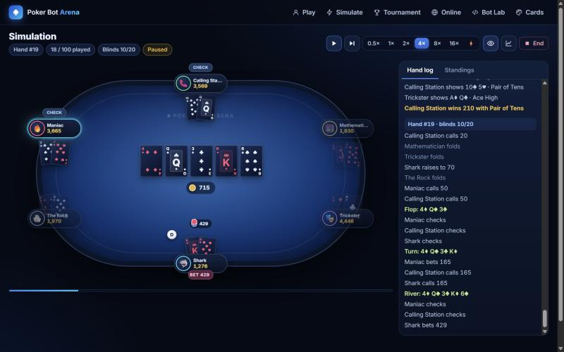
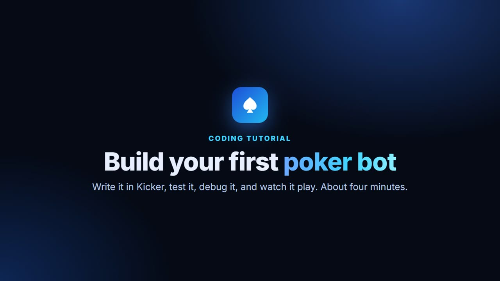
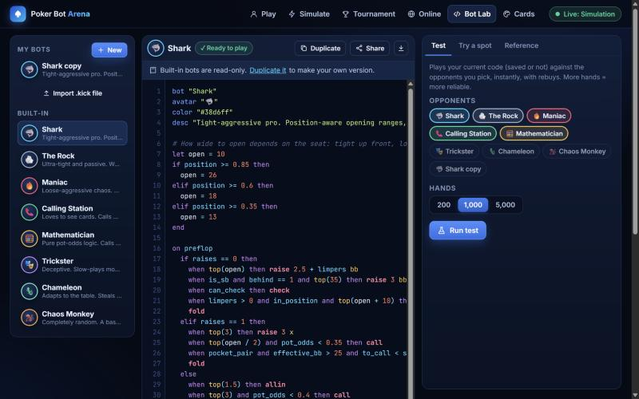

# Poker Bot Arena

No-limit Texas Hold'em in the browser where you **write poker bots in Kicker**, a small rule-based language made for poker, then watch them play: against eight built-in personalities, against each other, against your friends' bots, or against you.

**Play it:** https://henrywei57.github.io/poker-bot-arena/



No machine learning anywhere. A bot is a list of rules you can read top to bottom, like this:

```kicker
on preflop
  when hand in "TT+, AQs+, AKo" then raise 3 x     # premium hand: raise
  when top(20) and to_call <= 3 * bb then call      # decent hand, cheap price: call
  check                                             # otherwise check, or fold to a bet
end

on postflop
  when strength > 0.8 then bet 75% pot              # very strong: bet for value
  when equity > pot_odds then call                  # the price is right: call
  check
end
```

## Video tutorial

[](https://henrywei57.github.io/poker-bot-arena/#/tutorial)

**[Watch the coding tutorial](https://henrywei57.github.io/poker-bot-arena/#/tutorial)** (about 4 minutes, narrated, with captions and chapters). It writes a bot from an empty editor, shows a typo being caught, debugs it with *Try a spot*, benchmarks it over 1,000 hands and watches it play. You can also [download the MP4](media/tutorial.mp4).

## What you can do

- **Play vs bots.** Sit down yourself with up to eight bots. Fold / call / raise buttons, a bet slider with pot-size presets, and keyboard shortcuts (F, C, R, A).
- **Simulate.** Bots only. Watch 50 hands at 1×, 2×, 4×, 8× or 16× speed, or press ⚡ to run thousands instantly. Pause, step one action at a time, show every bot's cards, then get a leaderboard (net chips, BB/100, VPIP, PFR, aggression, showdowns) and a chip graph. Seeds make runs reproducible.
- **Tournaments.** Freezeouts from 2 to 90 players with rising blinds and antes. More than one table? Tables break and rebalance as players bust, down to a final table. Watch any table, play in it yourself, or **run a series of 10–250 tournaments instantly** to see which bot wins most.
- **Online tables.** Open a table and send friends the link. They join from their own browser **as themselves, or with a bot they wrote**. Chat, turn timer, seat management, reconnects.
- **Bot Lab.** A code editor with syntax highlighting and live error checking ("Unknown name `strenght`. Did you mean `strength`?"), a one-click benchmark against any opponents, a **Try a spot** debugger that deals a random situation and shows exactly what your bot sees and which line made its decision, a searchable language reference, share links, and `.kick` file import/export.
- **Cards & table.** Four face themes (Midnight, Classic, Neon, Minimal), a four-colour deck, three fonts, six card-back designs with any two colours and a monogram, card size, and six felt colours (or your own).



## The built-in personalities

Each one is an ordinary Kicker program: open it in the Bot Lab to read it, or duplicate it to make your own version.

| Bot | Style |
|---|---|
| 🦈 Shark | Tight-aggressive pro: position-aware ranges, value bets, disciplined folds |
| 🪨 The Rock | Ultra-tight and passive: premium hands only, mostly calls |
| 🔥 Maniac | Loose-aggressive: raises constantly, bluffs often |
| 📞 Calling Station | Calls with anything that might win |
| 🧮 Mathematician | Pure pot odds: calls only when equity beats the price |
| 🎭 Trickster | Slow-plays monsters, check-raises, bluffs scary cards |
| 🦎 Chameleon | Reads the table (VPIP, PFR, aggression) and adapts |
| 🐒 Chaos Monkey | Random: the baseline every real bot should beat |

## Kicker in one minute

- The program runs **top to bottom on every decision**. The first action it reaches (`fold`, `check`, `call`, `raise`, `bet`, `allin`) is the move. Reach none and the bot checks, or folds to a bet.
- `when <condition> then <statement>` for one-liners, `if / elif / else / end` for blocks, `on preflop` / `on flop, turn` / `on postflop` for streets.
- Sizes: `raise 3 bb`, `raise 2.5 x`, `bet 75% pot`, `bet pot`, `raise to 600`, `raise min`, `allin`. Sizes are always made legal for you.
- Ranges: `hand in "TT+, AQs+, KQs, 76s-54s, Axs"`.
- 90+ built-ins: `equity`, `strength`, `pot_odds`, `made`, `top_pair`, `flush_draw`, `position`, `in_position`, `raises`, `limpers`, `was_aggressor`, `opp_vpip`, `players_left`…
- `let` for this decision, `keep` to remember things between hands, `say` for a speech bubble, `log` for debugging.

Full reference: **[docs/LANGUAGE.md](docs/LANGUAGE.md)** (also built into the Bot Lab).

Kicker has no loops, no user functions and no access to the page or the network, so every program finishes instantly and a friend's bot is safe to run on your machine.

## Online play: how it works

The host's browser runs the game; guests connect to it directly over WebRTC using [PeerJS](https://peerjs.com/) (its free public server only introduces the browsers to each other). There is no game server and no account.

- Each guest only ever receives their own hole cards (plus anything shown at showdown).
- A guest who brings a bot sends its Kicker code; it runs in the host's sandboxed interpreter.
- If someone's connection drops, their seat checks or folds until they come back with the same tab.
- Keep the host tab open: closing it ends the table.
- Very strict networks (some offices and schools) block peer-to-peer connections; there is no relay server.

## Run it locally

You need [Node.js](https://nodejs.org) 18 or newer. There are no dependencies and no build step.

```bash
npm start      # serves the app at http://localhost:8090
```

```bash
npm test       # engine, evaluator, language, session and tournament tests
```

Other scripts: `npm run gen:preflop` rebuilds the preflop equity table, `npm run gen:docs` rebuilds `docs/LANGUAGE.md` from the built-in definitions.

### Re-recording the tutorial video

The video is made by a script, not by hand: `tools/tutorial/record.mjs` drives the real app in headless Chrome (typing, clicking, a drawn-on cursor and callouts from `tools/tutorial/overlay.js`), captures every frame, narrates each beat of `tools/tutorial/script.mjs` with a built-in Windows voice, and assembles `media/tutorial.mp4` with captions and chapters. It needs Windows, Google Chrome and [ffmpeg](https://ffmpeg.org/) on your PATH.

```bash
npm install
```

```bash
npm run video
```

Edit `tools/tutorial/script.mjs` to change what it says or does. Set `TUTORIAL_VOICE` to use another installed voice (for example `Microsoft David Desktop`).

## How it is built

Plain JavaScript modules, no framework.

```
src/engine/    cards, hand evaluator, Monte Carlo equity, rules engine, legal-action resolver
src/lang/      Kicker lexer, parser, checker and interpreter; built-ins (single source for the docs)
src/bots/      personalities (written in Kicker), the bot library, the bot agent
src/sim/       live session (pacing, logs, snapshots), headless runner, stats, tournaments
src/net/       online host and guest over PeerJS
src/ui/        table renderer, card art (SVG), action bar, editor, chart, screens
tests/         node:test suites
tools/         preflop table and docs generators, dev server, tutorial video recorder
media/         the tutorial video, its captions, chapters and poster
```

The rules engine follows standard no-limit rules, and the tests check them:

- Heads-up: the button posts the small blind, acts first before the flop and last after it.
- The minimum raise is the size of the last full raise; an all-in for less does not reopen betting for players who already acted (unless short all-ins add up to a full raise).
- Nobody can raise when everyone else is all-in; a short big blind still makes others call a full big blind.
- Uncalled chips are returned; side pots are built by contribution level; split pots give odd chips to the first winner left of the button.
- The 7-card evaluator is checked against an independent brute-force evaluator on 40,000 random hands, and 30,000 fuzzed hands verify that chips are never created or lost.

## Deploy your own copy

The site is the repo root, so GitHub Pages can serve it directly: **Settings → Pages → Deploy from a branch → `main` / `(root)`**.

## License

[MIT](LICENSE). Play money only.
